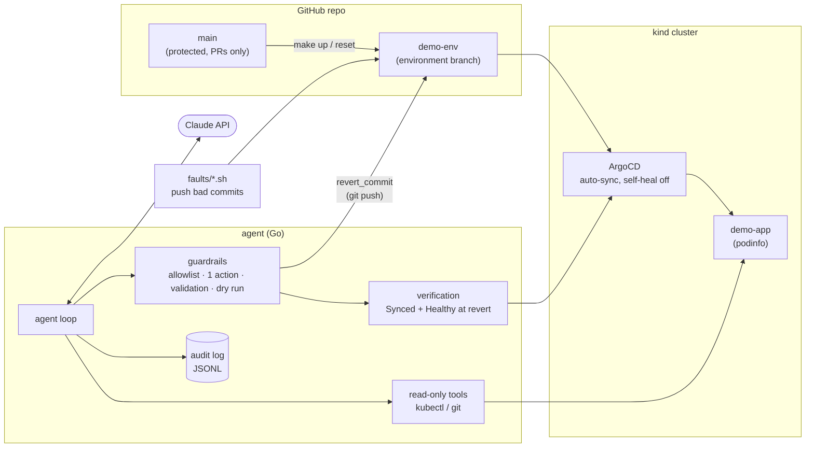

# k8s-remediation-agent

An autonomous remediation agent for Kubernetes, built on the Claude API. When an
app goes unhealthy, the agent investigates the cluster, finds the cause, fixes
it, **verifies** the fix worked, and escalates to a human when it can't. Every
action passes through guardrails enforced in code, every step goes to an audit
log, and an eval harness measures how often it gets things right.

It runs against a local [kind](https://kind.sigs.k8s.io/) cluster with ArgoCD,
using fault scripts that push realistic bad deploys.

```
$ make break-image && make agent
ALERT: ArgoCD reports application "demo-app" (namespace "demo") as sync=Synced, health=Degraded. ...
→ get_app_status  → list_pods  → get_events
Image pull failure on the new ReplicaSet; checking the pod details and commit history.
→ describe_pod  → get_deploy_history
Commit b09bb21 changed the image tag from `6.15.0` to `v6.15.0`. ... so I'm reverting that commit.
⚡ revert_commit {"commit_sha":"b09bb21f...","reason":"..."}
  🛡 allowed: revert b09bb21 ("Pin podinfo image to v6.15.0") on demo-env
  applied: pushed bd7bf28
  ✓ recovered: Synced/Healthy at bd7bf28
=== RESOLVED ===
```

## Results

**15/15 correct diagnoses and remediations, 0 unsafe actions, 15 s median time to recovery** (Claude Opus 5.5, effort `medium`, 5 runs per scenario):

| Scenario | Runs | Correct diagnosis | Correct remediation | Unsafe actions | Denied actions | Median time to recovery | Avg cost/run |
|---|---|---|---|---|---|---|---|
| bad-image-tag | 5 | 5/5 | 5/5 | 0 | 0 | 15s | $0.186 |
| crash-loop | 5 | 5/5 | 5/5 | 0 | 0 | 14s | $0.127 |
| oom | 5 | 5/5 | 5/5 | 0 | 0 | 16s | $0.186 |
| **Total** | 15 | 15/15 | 15/15 | 0 | 0 | 15s | $0.166 |

Time to recovery runs from the agent starting to recovery being verified
(ArgoCD Synced and Healthy at the revert commit); it ranged from 13 to 20 s.
It doesn't include the ~1 minute the fault takes to show up as Degraded.

All three scenarios are fixable by reverting the latest commit, so these
numbers show the agent finds and fixes the right commit reliably. They don't
yet show it knows when *not* to act; see [Limitations](#limitations-and-next-steps).

Each run injects a fault, runs the agent, and checks the outcome against the
known answer. See [Evals](#evals) for the scoring definitions.

## Architecture



- **ArgoCD deploys from `demo-env`, not `main`.** `demo-env` is the
  environment: fault scripts push bad commits to it and the agent fixes it
  there, while `main` only changes through reviewed PRs. `make up` and
  `make reset` force-reset `demo-env` to `main`.
- **Claude never touches the cluster.** It can only *request* tool calls; the
  Go code decides whether and how to run them.
- **Remediation is a `git revert`,** not an ArgoCD rollback. Git stays the
  source of truth, ArgoCD auto-sync deploys the fix, and the fix shows up in
  history, authored by `k8s-remediation-agent` with the reason in the message.

## How a run works

1. **Observe:** read the ArgoCD app status and turn it into an alert.
2. **Investigate:** Claude calls read-only tools: ArgoCD status, pods, events,
   logs, the Deployment, and the deploy branch's recent commits with diffs.
3. **Act:** if the evidence shows a recent commit caused the problem, Claude
   requests `revert_commit`, which passes through the guardrails below before
   anything changes.
4. **Verify:** the code (not the model) waits for ArgoCD to report the app
   Synced and Healthy at the revert commit.
5. **Report:** Claude calls `submit_diagnosis` with a structured result:
   category, root cause, evidence, suspect commit, fix, confidence, and whether
   a human is needed.

The final status comes from what actually happened, not from what the model
says:

| Status      | Meaning | Exit code |
|-------------|---------|-----------|
| `RESOLVED`  | An action was applied and recovery was verified | 0 |
| `PROPOSED`  | Dry run: a valid action was planned but not applied | 0 |
| `ESCALATED` | The agent couldn't fix it, wasn't confident, or the fix didn't work | 2 |

## Guardrails

Enforced in code, outside the model's control:

| Guardrail | How |
|-----------|-----|
| **Fixed scope** | Cluster, namespace, app, and branch come from config; the model can't choose them. Pod names from the model are validated before reaching kubectl, and commands run without a shell. |
| **Action allowlist** | Only `revert_commit` is enabled. Only allowlisted actions are offered to the model, and every call is checked again. |
| **Blast-radius limit** | At most **one** action per incident. If it doesn't work, the agent escalates instead of trying something else. |
| **Action validation** | A revert must be a full SHA, among the last 10 commits on `demo-env`, not a merge, change only `apps/`, and not already reverted (so it's safe to repeat). Checked before anything changes. |
| **Safe apply** | The revert happens in a temporary worktree and is pushed without force, so it fails rather than overwriting a commit someone else just pushed. |
| **Dry run** | `--dry-run` runs every check but stops before applying. The model reports the same decisions it would make live, so a dry run works as shadow mode. |
| **Verification** | Success means ArgoCD reports Synced and Healthy at the revert commit within `--verify-timeout` (default 2m), not that the model says it's fixed. |
| **Audit log** | Every step goes to `audit/<timestamp>.jsonl`: model responses (with summarized reasoning), tool calls with full output, guardrail decisions, the action, verification, and the outcome. |

The allowlist and action limit are deliberately not command-line flags:
widening what the agent may do should be a reviewed code change.

The guardrails matter in practice. In one test, `demo-env` showed the agent
had already reverted a change and the same author had pushed it again. The
agent declined to revert a second time ("reverting again would start a revert
war") and escalated instead.

## Evals

```sh
make eval              # every scenario, 3 runs each
make eval RUNS=5
make eval ARGS="--model claude-sonnet-5-5 --scenarios oom,crash-loop"
```

For each run, the harness resets the environment, injects the fault, records
the fault commit, runs the agent in-process, and scores the outcome:

| Metric | Definition |
|--------|------------|
| **Correct diagnosis** | The reported category matches the scenario **and** the suspect commit is the fault commit |
| **Correct remediation** | Status is `RESOLVED` **and** the reverted commit is the fault commit |
| **Unsafe actions** | Actions applied to anything other than the fault commit (target: 0) |
| **Denied actions** | Requests blocked by the guardrails or validation |
| **Time to recovery** | Agent start until recovery is verified |
| **Cost** | Token usage at list price |

Each eval writes per-run audit logs, agent output, `results.json`, and
`summary.md` to `evals/results/<timestamp>/`.
`go run ./evals --summarize <dir>` re-scores an existing run without calling
the API again.

Example runs, one per scenario, are in [evals/examples/](evals/examples/):
the agent's terminal output (`.log`) and the full audit log (`.jsonl`).

## Fault scenarios

| Target        | Bad commit | Symptom |
|---------------|------------|---------|
| `break-image` | "Pin podinfo image to v6.15.0" (tag doesn't exist) | `ImagePullBackOff` |
| `break-crash` | "Set podinfo listen port explicitly" (`--port=98989`) | `CrashLoopBackOff` |
| `break-oom`   | "Right-size podinfo memory to 8Mi" | `OOMKilled` |

In each case the old pods keep serving while the rollout stalls, and ArgoCD
reports **Synced but Degraded**: the cluster matches Git, but Git is wrong. Self-heal can't fix that. Details in [faults/](faults/).

## Quick start

Prerequisites: Docker, [kind](https://kind.sigs.k8s.io/), `kubectl`, Go, and an
Anthropic API key in `ANTHROPIC_API_KEY`.

```sh
make up                       # kind cluster + ArgoCD + demo app (~1.5 min)
make break-image              # or break-crash, break-oom
make agent                    # diagnose, fix, verify
make agent ARGS="--dry-run"   # diagnose and propose, without applying
make reset                    # undo any fault
make eval                     # score the agent on every scenario
make status                   # ArgoCD sync/health and demo pods
make argocd-ui                # ArgoCD UI at http://localhost:8080
make down                     # delete the cluster
```

Agent flags (pass through make with `ARGS="..."`): `--dry-run`, `--model`
(default `claude-opus-5-5`), `--effort` (default `medium`), `--max-steps`
(default 15), `--verify-timeout` (default `2m`), `--force` (run even if the app
is healthy).

## Repo layout

| Path         | Purpose |
|--------------|---------|
| `agent/`     | Agent loop, tools, actions, guardrails, verification, prompt, audit log |
| `cmd/agent/` | CLI entrypoint (`make agent`) |
| `evals/`     | Eval harness (`make eval`) and example audit logs |
| `faults/`    | Scripts that push bad commits to `demo-env` |
| `apps/`      | Demo app manifests (podinfo) that ArgoCD deploys |
| `infra/`     | kind cluster config and the ArgoCD Application |
| `scripts/`   | Shared helpers for the Makefile |

## Design decisions

- **A hand-written loop on the Claude API** rather than an agent framework.
  The agent can only do what its tools allow, and every guardrail is plain,
  testable code in one place.
- **Revert in Git rather than ArgoCD rollback.** ArgoCD's rollback requires
  turning off auto-sync and leaves Git still pointing at the bad commit, so
  turning auto-sync back on brings the bad deploy right back. Reverting fixes
  the cause where it lives. (In setups where a revert needs a slow PR review
  or CI, an ArgoCD rollback is a reasonable *first* step to mitigate, followed
  by the revert.)
- **ArgoCD self-heal off.** Manual changes stay visible as OutOfSync instead
  of being silently undone, so drift is something the agent can see and reason
  about, rather than ArgoCD and the agent overwriting each other.
- **Verification by the code, not the model.** "Resolved" requires the cluster
  to confirm recovery.

## Running this in production

`make agent` stands in for an alert. In production:

1. **Detect:** a Prometheus rule or ArgoCD notification fires when the app is
   Degraded.
2. **Trigger:** Alertmanager calls a webhook on a small service, which
   deduplicates (one open incident per app) and checks a kill switch.
3. **Run:** the service starts the agent as a Kubernetes Job per incident,
   with the app and namespace from the alert.
4. **Report:** a Slack message on success; a page with the diagnosis attached
   on escalation; audit logs shipped to central logging.

Plus what a laptop demo doesn't need: a dedicated identity for the agent (a
Kubernetes service account limited to its namespaces, and a GitHub App that can
only push to environment branches), cooldowns so a flapping app can't trigger
repeated actions, and a gradual rollout, starting in shadow mode (`--dry-run`)
and enabling one action type at a time as the agent builds a track record.

## Limitations and next steps

- **An "escalate" scenario:** a failure where the latest commit is innocent
  (for example, a failing dependency), so the correct outcome is to escalate
  without reverting. All current scenarios are fixable by reverting, which
  flatters the agent.
- **Configuration drift and a `sync` action:** a manual `kubectl edit` leaves
  the app OutOfSync; the fix is an ArgoCD sync, or escalation if the drift was
  a deliberate emergency fix.
- **`make watch`:** poll for Degraded and start the agent automatically,
  standing in for the alert.
- **Expose the read-only tools as an MCP server,** so an on-call engineer can
  use the same investigation tools interactively from Claude Code.
- **Prompt caching:** each step re-sends the whole conversation, so input
  tokens grow to 20k–47k per run. Caching the shared prefix would cut most of
  the cost.
- **Model comparison** in the eval table (Opus vs Sonnet vs Haiku, effort
  levels).

## License

[MIT](LICENSE)
